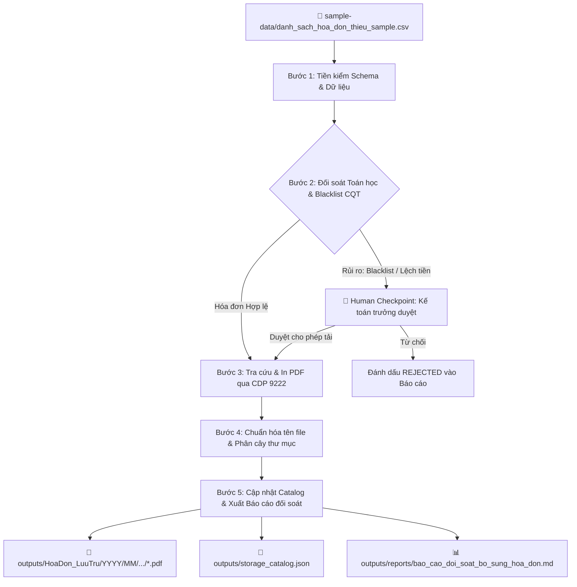

# KỸ NĂNG: GDT INVOICE RETRIEVER (TÌM KIẾM & LƯU TRỮ HÓA ĐƠN THIẾU)

> **Mục tiêu kỹ năng:** Tự động hóa mắt xích tìm kiếm, tải về và lưu trữ các hóa đơn điện tử mua vào còn thiếu file PDF từ Cổng thông tin Tổng cục Thuế (`hoadondientu.gdt.gov.vn`) để phục vụ công tác hoàn thiện hồ sơ chứng từ của kế toán nội bộ.

---

## 1. THÔNG TIN KỸ NĂNG
- **Tên kỹ năng:** `gdt-invoice-retriever`
- **Mô tả chức năng:**
  Hệ thống kỹ năng điều phối toàn diện: đọc danh sách hóa đơn thiếu từ file bảng tính Excel/CSV, tiền kiểm tính toàn vẹn và rủi ro thuế, kết nối Chrome qua cổng CDP 9222 để tra cứu trên trang thuế, kích hoạt cơ chế in ấn ảo (Chromium Native Print / Microsoft Print to PDF) xuất bản in PDF sắc nét 1:1, tự động đổi tên tệp và sắp xếp vào cây thư mục phân cấp Năm/Tháng/Mẫu số/MST người bán.

---

## 2. INPUT CẦN THIẾT (YÊU CẦU ĐẦU VÀO)
Để kích hoạt kỹ năng, hệ thống cần các nguồn dữ liệu đầu vào sau:
1. **File danh sách hóa đơn cần tìm:** `sample-data/danh_sach_hoa_don_thieu_sample.csv` (hoặc file `.xlsx` tương đương).  
   *Các trường tối thiểu bắt buộc:* `ngay_hoa_don`, `mst_nguoi_ban`, `mau_so`, `ky_hieu`, `so_hoa_don`.
2. **Cơ sở tri thức & Tham số nghiệp vụ:** `knowledge_base/cau_hinh_nghiep_vu_hoa_don.json` (chứa quy tắc độ dài MST, danh sách đen CQT, quy ước đặt tên file).
3. **Môi trường kết nối:** Trình duyệt Google Chrome mở cổng điều khiển từ xa `--remote-debugging-port=9222` đã đăng nhập sẵn tài khoản Cổng Thuế của doanh nghiệp.

---

## 3. QUY TRÌNH THỰC THI 5 BƯỚC (5-STAGE EXECUTION PIPELINE)

### Chi tiết từng bước:
- **Bước 1 — Tiền kiểm Schema & Dữ liệu:**
  - Đọc file đầu vào, khử khoảng trắng thừa, chuẩn hóa định dạng số hóa đơn sang 7 chữ số (ví dụ: `302` $\rightarrow$ `0000302`).
  - Kiểm tra độ dài MST: 10 chữ số (doanh nghiệp độc lập) hoặc 14 chữ số (chi nhánh/đơn vị phụ thuộc). Nếu sai $\rightarrow$ gắn cờ lỗi format.
- **Bước 2 — Đối soát Toán học & Blacklist:**
  - Kiểm tra $|\text{Tổng tiền} - (\text{Chưa thuế} + \text{Thuế})| \le 10$đ.
  - So khớp MST với danh mục doanh nghiệp ma / rủi ro cao trong `knowledge_base/`. Nếu trùng $\rightarrow$ dừng và chuyển sang Human Checkpoint.
- **Bước 3 — Tra cứu & Kết xuất Máy in ảo:**
  - Kết nối cổng CDP 9222, định vị màn hình "Xem chi tiết" hóa đơn.
  - Kích hoạt lệnh `Page.printToPDF` với cấu hình khổ giấy A4, in hình nền `printBackground: true`, margins chuẩn.
  - Tải file PDF bản in sắc nét 1:1, kiểm tra dung lượng $> 0$ bytes và chữ ký `%PDF-`.
- **Bước 4 — Chuẩn hóa tên file & Phân cây thư mục:**
  - Đổi tên tệp theo quy chuẩn: `[YYYYMMDD]_[MauSo]_[MST]_[KyHieu]_[SoHD].pdf`.
  - Phân loại và di chuyển file an toàn (Atomic Move) vào cây thư mục:  
    `outputs/HoaDon_LuuTru/{YYYY}/{MM}/MauSo_{1_GTGT | 2_BanHang}/{MST}_{TenNhaCungCap}/`.
  - Kiểm tra chống trùng lặp; nếu có hóa đơn cùng số nhưng nội dung thay đổi $\rightarrow$ lưu version `_v2`.
- **Bước 5 — Cập nhật Catalog & Xuất Báo cáo đối soát:**
  - Đồng bộ danh mục vào file `outputs/storage_catalog.json` theo chuẩn Handoff Schema đồng nhất.
  - Lập Báo cáo đối soát hoàn thiện hồ sơ chứng từ gửi Kế toán trưởng và Ban Giám đốc.

---

## 4. OUTPUT MONG ĐỢI (KẾT QUẢ ĐẦU RA)
1. **Cây thư mục lưu trữ hóa đơn:** `outputs/HoaDon_LuuTru/` chứa các tệp PDF chuẩn, chia ngăn nắp theo Năm $\rightarrow$ Tháng $\rightarrow$ Mẫu số $\rightarrow$ MST nhà cung cấp.
2. **Sổ danh mục tập trung:** `outputs/storage_catalog.json` chứa toàn bộ metadata, đường dẫn tệp và trạng thái xử lý của từng hóa đơn.
3. **Báo cáo đối soát nghiệp vụ:** `outputs/reports/bao_cao_doi_soat_bo_sung_hoa_don.md` tổng hợp rõ ràng:
   - Tổng số hóa đơn cần tìm: ...
   - Số hóa đơn đã tải và lưu trữ thành công: ...
   - Số hóa đơn bị lỗi / rủi ro thuế đã cách ly: ...
   - Danh sách chi tiết các hóa đơn cần bổ sung chứng từ giải trình.
