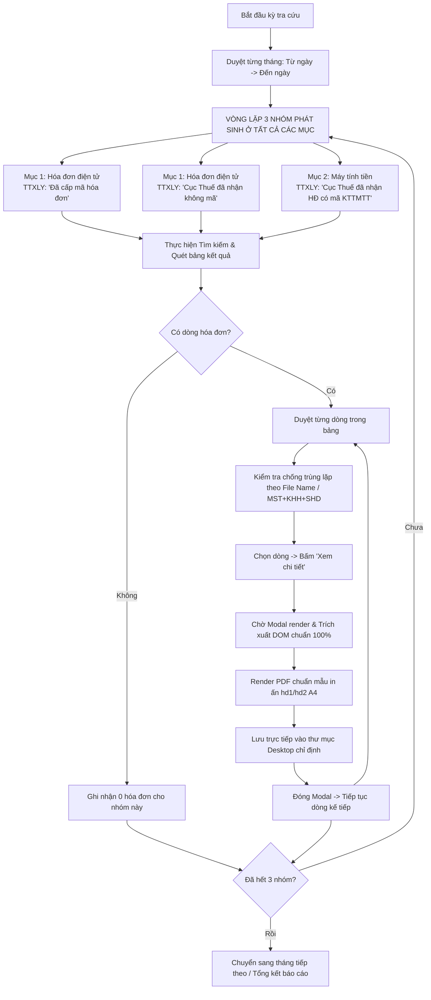

# Invoice Downloader AI — Hướng Dẫn Vận Hành In Hóa Đơn Sang PDF (Microsoft Print to PDF)

Skill này định nghĩa quy trình chuẩn để AI Agent tự động hóa thao tác tra cứu trên Cổng thông tin Hóa đơn điện tử Tổng cục Thuế (`hoadondientu.gdt.gov.vn`), mở màn hình xem hóa đơn và kích hoạt lệnh **"In hóa đơn"** kết nối tới máy in ảo **"Microsoft Print to PDF" / Chromium Print Engine** để kết xuất ra file PDF chất lượng cao, chuẩn in ấn A4 và giữ trọn 100% hình thức hiển thị thực tế.

---

## 1. Nguyên Tắc Cốt Lõi: Cơ Chế "In Hóa Đơn -> Microsoft Print to PDF"

### 1.1. Tại sao sử dụng cơ chế In hóa đơn sang PDF?
- **Chuẩn hóa in ấn (Print Media Accuracy)**: Khi kích hoạt chức năng "In hóa đơn", website áp dụng các quy tắc `@media print` chuyên biệt, tự động ẩn đi các nút bấm/khung viền của trình duyệt và tối ưu hóa vị trí bảng biểu, chữ ký số, hoa văn nền và mã QR.
- **Tránh nhược điểm file tải thô**: File tải về qua nút Download XML/HTM/PDF thô thường bị lỗi font, vỡ khung viền hoặc thiếu stylesheet. Cơ chế Print to PDF sử dụng trực tiếp engine in của hệ thống (tương đương chọn máy in đích **Microsoft Print to PDF** trong hộp thoại Print) để tạo ra bản PDF sắc nét, đúng khổ giấy A4.
- **Tự động hóa hoàn toàn (Headless / CDP Printing)**: Qua giao thức Chrome DevTools Protocol, lệnh in được điều hướng trực tiếp thành file PDF mà không làm kẹt hộp thoại in của hệ điều hành, giúp xử lý hàng loạt siêu tốc.

### 1.2. Nguyên tắc bảo toàn dữ liệu & bảo mật
1. **Bảo toàn dữ liệu 100%**: Giữ nguyên mọi trường thông tin gốc (MST, Tên người bán/người mua, Ký hiệu, Số HĐ, Ngày lập, Chi tiết hàng hóa, Đơn giá, Thành tiền, Thuế suất, Tổng tiền thanh toán, Tiền chữ, MCCQT). Tuyệt đối không làm tròn, không sửa đổi nội dung của hóa đơn tải xuống.
2. **Bảo mật tuyệt đối**: Người dùng tự đăng nhập và nhập mã CAPTCHA/OTP trên trình duyệt. AI chỉ tự động hóa các thao tác tra cứu, in ấn và lưu file.

### 1.3. Quy Chuẩn Khuôn Mẫu Hóa Đơn Chuẩn (Mẫu `hd1.pdf` & `hd2.pdf`)
Mọi file PDF hóa đơn khi tải xuống / kết xuất **bắt buộc phải lưu dưới khuôn mẫu chuẩn 1:1** như các mẫu tham chiếu:
- Mẫu hóa đơn tham chiếu 1: [`knowledge-base/hd1.pdf`](file:///d:/my-workspace-20260906T133958Z-1-001/my-workspace/knowledge-base/hd1.pdf)
- Mẫu hóa đơn tham chiếu 2: [`knowledge-base/hd2.pdf`](file:///d:/my-workspace-20260906T133958Z-1-001/my-workspace/knowledge-base/hd2.pdf)

**Các yếu tố định dạng bắt buộc của khuôn mẫu:**
- **Khổ in & Canh lề**: Khổ `A4 Portrait`, lề `Top 8mm`, `Bottom 8mm`, `Left 6mm`, `Right 6mm`.
- **Khung viền**: Khung viền kép hoa văn màu vàng hoàng gia (`#b3882a`).
- **Hình nền Watermark**: Nền chìm họa tiết Trống đồng Đông Sơn và hoa văn văn hóa Việt Nam độ nét cao.
- **Mã QR Code**: Khối QR Code kiểm tra hóa đơn tại góc trên bên trái.
- **Thông tin hóa đơn**: Mẫu số, Ký hiệu, Số hóa đơn (được định dạng zfill 7 chữ số) đặt tại góc trên bên phải.
- **Tiêu đề trung tâm**: `HOÁ ĐƠN GIÁ TRỊ GIA TĂNG`, `Ngày ... tháng ... năm ...`, `MCCQT: ...`.
- **Thông tin Người Bán & Người Mua**: Định dạng dạng danh sách có nhãn in đậm, đường chấm dóng hàng và đường kẻ vàng phân tách.
- **Bảng dữ liệu hàng hóa**: Đầy đủ 10 cột chuẩn: *STT, Tính chất, Loại hàng hoá đặc trưng, Tên hàng hóa dịch vụ, ĐVT, Số lượng, Đơn giá, Chiết khấu, Thuế suất, Thành tiền chưa có thuế GTGT*.
- **Khung tổng hợp & Thuế**: Bảng phân tách thuế suất bên trái, bảng tổng tiền thanh toán và số tiền viết bằng chữ bên phải.
- **Chữ ký điện tử**: Khung viền xanh lá với biểu tượng kiểm tra hợp lệ `Signature Valid`, Ký bởi bên bán, Ký ngày giờ chính xác.
- **Lưu ý quan trọng**: Khuôn mẫu chỉ dùng để định dạng hiển thị, **toàn bộ nội dung dữ liệu bên trong phải được trích xuất nguyên vẹn 100% từ Cổng Tổng cục Thuế, không chỉnh sửa hay thay đổi bất kỳ số liệu nào**.

### 1.4. Quy Chuẩn Khuôn Mẫu Hóa Đơn Điều Chỉnh & Hóa Đơn Thay Thế
Đối với các hóa đơn có phát sinh điều chỉnh hoặc thay thế theo Nghị định 123/2020/NĐ-CP và Thông tư 78/2021/TT-BTC, khuôn mẫu tải xuống bắt buộc phải tuân thủ chuẩn trình bày sau:

1. **Hóa Đơn Điều Chỉnh (Adjustment Invoice):**
   - **Tiêu đề hóa đơn:** Tự động gắn nhãn phân loại, ví dụ: `HOÁ ĐƠN GIÁ TRỊ GIA TĂNG (ĐIỀU CHỈNH)` hoặc `HOÁ ĐƠN BÁN HÀNG (ĐIỀU CHỈNH)`.
   - **Badge nhận diện:** Hiển thị khối nhãn nổi bật màu cam hổ phách: `[ HÓA ĐƠN ĐIỀU CHỈNH ]` (`#ea580c` / `#fff7ed`).
   - **Khung Banner tham chiếu (Reference Banner):** Đặt ngay dưới tiêu đề hóa đơn với viền nét đứt thanh lịch, hiển thị đầy đủ:
     *`Điều chỉnh cho: ký hiệu mẫu số hóa đơn [Mẫu số], ký hiệu hóa đơn [Ký hiệu], số hóa đơn [Số HĐ], ngày lập [Ngày/Tháng/Năm] | Lý do: [Lý do điều chỉnh] | Văn bản: [Số văn bản thỏa thuận]`*
   - **Dòng thông tin tham chiếu:** Bổ sung dòng *Thông tin điều chỉnh* trong mục người mua để phục vụ đối soát kế toán.
   - **Xử lý số liệu & Tiền chữ:** Hỗ trợ đầy đủ số tiền điều chỉnh tăng (`+`) hoặc giảm (`-`), giữ nguyên chuỗi tiền chữ của Cổng Thuế (ví dụ: `Điều chỉnh tăng một nghìn năm trăm đồng chẵn.` hoặc `Điều chỉnh giảm ...`).

2. **Hóa Đơn Thay Thế (Replacement Invoice):**
   - **Tiêu đề hóa đơn:** Tự động gắn nhãn phân loại, ví dụ: `HOÁ ĐƠN GIÁ TRỊ GIA TĂNG (THAY THẾ)` hoặc `HOÁ ĐƠN BÁN HÀNG (THAY THẾ)`.
   - **Badge nhận diện:** Hiển thị khối nhãn nổi bật màu xanh dương hoàng gia: `[ HÓA ĐƠN THAY THẾ ]` (`#2563eb` / `#eff6ff`).
   - **Khung Banner tham chiếu (Reference Banner):** Đặt ngay dưới tiêu đề hóa đơn với viền nét đứt thanh lịch, hiển thị đầy đủ:
     *`Thay thế cho: ký hiệu mẫu số hóa đơn [Mẫu số], ký hiệu hóa đơn [Ký hiệu], số hóa đơn [Số HĐ], ngày lập [Ngày/Tháng/Năm] | Lý do: [Lý do thay thế] | Văn bản: [Số văn bản thỏa thuận]`*
   - **Dòng thông tin tham chiếu:** Bổ sung dòng *Thông tin thay thế* trong mục người mua.

---

## 2. Quy Chuẩn Bao Quát Toàn Diện Mọi Hóa Đơn Phát Sinh (Tất Cả Các Mục)

> [!IMPORTANT]
> **Cổng Hóa đơn điện tử phân tách hóa đơn thành nhiều mục (subtab) và nhiều trạng thái xử lý riêng biệt (`#ttxly`).** Nếu chỉ tra cứu mặc định, Agent sẽ bỏ sót toàn bộ hóa đơn không mã và hóa đơn máy tính tiền. Do đó, Agent bắt buộc phải thực hiện quét đối soát theo ma trận **3 Nhóm Phát Sinh / Tất Cả Các Mục**:

1. **Mục "Hóa đơn điện tử" (Subtab 0)**:
   - **Nhóm 1 — "Đã cấp mã hóa đơn"**: Tra cứu các hóa đơn có mã của Cơ quan Thuế.
   - **Nhóm 2 — "Cục Thuế đã nhận không mã"**: Tra cứu các hóa đơn điện tử không mã (xăng dầu, điện, nước, viễn thông, cước vận tải biển/cảng biển...).
2. **Mục "Hóa đơn có mã khởi tạo từ máy tính tiền" (Subtab 1)**:
   - **Nhóm 3 — "Cục Thuế đã nhận hóa đơn có mã khởi tạo từ máy tính tiền"**: Chuyển sang tab máy tính tiền để tra cứu các hóa đơn khởi tạo từ máy tính tiền (nhà hàng, khách sạn, bán lẻ, siêu thị, trung tâm thương mại...).

### Sơ Đồ Quy Trình Tải Toàn Diện (All-Categories Workflow)



---

## 3. Hướng Dẫn Thao Tác Kỹ Thuật Chi Tiết

### Bước 1: Kết nối và Chuyển mục tra cứu
- Kết nối tới Chrome qua CDP (`http://localhost:9222`).
- Chuyển tab sang *Tra cứu hóa đơn điện tử mua vào* (hoặc *bán ra*).
- Điều hướng đúng mục con:
  - Nếu quét nhóm Hóa đơn điện tử: Chuyển active tab về `Hóa đơn điện tử` (Subtab 0).
  - Nếu quét nhóm Máy tính tiền: Chuyển active tab về `Hóa đơn có mã khởi tạo từ máy tính tiền` (Subtab 1).

### Bước 2: Thiết lập Bộ Lọc Thời Gian và Trạng Thái Xử Lý (#ttxly)
- Thiết lập khoảng ngày an toàn qua React Fiber của Ant Design (`tngay`, `dngay`) theo từng chu kỳ tối đa 31 ngày.
- Mở dropdown `#ttxly` và chọn chính xác giá trị tương ứng:
  1. `"Đã cấp mã hóa đơn"`
  2. `"Cục Thuế đã nhận không mã"`
  3. `"Cục Thuế đã nhận hóa đơn có mã khởi tạo từ máy tính tiền"`
- Bấm nút **Tìm kiếm** (`button[type="submit"]`).

### Bước 3: Mở màn hình xem và Chờ render
- Xác định bảng dữ liệu trong tabpane đang active (`.ant-tabs-content > .ant-tabs-tabpane:not(.ant-tabs-tabpane-inactive)`).
- Click chọn dòng hóa đơn (`tr`).
- Bấm nút **"Xem chi tiết"** (`button:has(#clip-icon_xemchitiet):not([disabled])`).
- Chờ Modal popup hiển thị hoàn chỉnh dữ liệu:
  - Hỗ trợ cả hóa đơn 10 cột (Hóa đơn GTGT) và 9 cột (Hóa đơn bán hàng / máy tính tiền).
  - Trích xuất đầy đủ MCCQT có dấu gạch ngang (ví dụ `M2-26-OZXHM-00000000017`).

### Bước 4: Kích hoạt Lệnh In và Xuất PDF Chuẩn Mẫu (hd1/hd2)
- Render file PDF với các thông số:
  - Khổ giấy (*Page size*): `A4 Portrait`.
  - Canh lề (*Margins*): `Top 8mm`, `Bottom 8mm`, `Left 6mm`, `Right 6mm`.
  - In nền đồ họa (*Print background*): `True`.
  - Giữ trọn vẹn hoa văn trống đồng Đông Sơn, viền vàng hoàng gia, mã QR Code và chữ ký số.
- Lưu file trực tiếp vào thư mục Desktop chỉ định (ví dụ `C:\Users\admin\Desktop\HSCC\`).

### Bước 5: Đóng Modal và Xác minh chất lượng
- Đóng popup modal qua nút đóng hoặc phím `Escape`.
- Kiểm tra dung lượng file PDF > 0 KB, các trường thông tin hiển thị sắc nét, không bị lỗi font Unicode tiếng Việt.

---

## 4. Quy Chuẩn Đặt Tên File Sau Khi In

Mỗi file PDF xuất ra phải được đặt tên tự động theo cấu trúc:

1. **Đầy đủ ký hiệu:**
   ```text
   YYYYMMDD_MST_KYHIEU_SOHOADON.pdf
   ```
   *Ví dụ:* `20260731_0100100417069_K26TBP_0350471.pdf`

2. **Khi không có ký hiệu:**
   ```text
   YYYYMMDD_MST_SOHOADON.pdf
   ```
   *Ví dụ:* `20260731_0100100417069_0350471.pdf`

---

## 5. Tài Liệu Kỹ Thuật & Script Mẫu

- [Đặc Tả Kỹ Thuật In Hóa Đơn & Print Engine](file:///d:/my-workspace-20260906T133958Z-1-001/my-workspace/.agents/skills/invoice-downloader/references/render-pipeline-spec.md)
- [Script In Hóa Đơn Sang PDF Chuẩn Hóa](file:///d:/my-workspace-20260906T133958Z-1-001/my-workspace/.agents/skills/invoice-downloader/scripts/extract_invoice_pdf.py)
