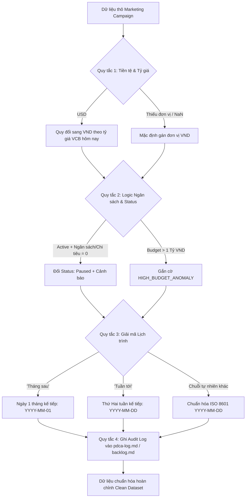

# Marketing Healing Skill — Cơ Chế Tự Phục Hồi Dữ Liệu Chiến Dịch Marketing

Skill này thiết lập quy trình **Tự Phục Hồi Dữ Liệu (Self-Healing Data Engine)** tự động phát hiện, chuẩn hóa và khắc phục các điểm bất thường trong bảng theo dõi chiến dịch Marketing ([marketing_campaigns.xlsx](file:///d:/my-workspace-20260906T133958Z-1-001/my-workspace/marketing_campaigns.xlsx)).

---

## 📌 4 Quy Tắc Tự Phục Hồi Bắt Buộc (Core Rules)



---

### 🔹 Quy Tắc 1 — Chuẩn Hóa Tiền Tệ & Quy Đổi Tỷ Giá VCB
- **Mục tiêu:** Đồng nhất toàn bộ dữ liệu tài chính về đơn vị cơ sở `VND` để phục vụ báo cáo và phân tích tập trung.
- **Chi tiết xử lý:**
  1. **Đơn vị USD (`USD` hoặc ký hiệu `$`, `usd`):**
     - Tra cứu tỷ giá Vietcombank (VCB) ngày hiện tại (hoặc tỷ giá tham chiếu VCB niêm yết: **25,780 VND/USD** / Tỷ giá chuyển khoản VCB).
     - Quy đổi: $\text{Budget}_{\text{VND}} = \text{Budget}_{\text{USD}} \times \text{Tỷ giá VCB}$.
     - Ghi nhận `Original_Currency = 'USD'`, `Exchange_Rate = 25,780` và cập nhật `Currency = 'VND'`.
  2. **Thiếu đơn vị tiền tệ (`NaN`, `None`, rỗng `""`):**
     - Mặc định quy chuẩn tự động: Gán `Currency = 'VND'`.
     - Ghi log: *"Thiếu đơn vị tiền tệ → Đã tự động mặc định VND"*.

---

### 🔹 Quy Tắc 2 — Kiểm Tra Logic Ngân Sách & Trạng Thái (Status Healing)
- **Mục tiêu:** Ngăn chặn việc hiển thị chiến dịch đang chạy (`Active`) nhưng thực tế không có ngân sách hoặc chi tiêu bằng 0 gây sai lệch KPI.
- **Chi tiết xử lý:**
  1. **Điều kiện xung đột:** `Status == 'Active'` VÀ (`Budget == 0` HOẶC `Actual_Spend == 0`).
  2. **Hành động tự phục hồi:**
     - Tự động cập nhật: `Status = 'Paused'`.
     - Cảnh báo: `Alert = '[WARNING] Active campaign with 0 spend/budget auto-paused'`.
  3. **Ngân sách đột biến (> 1,000,000,000 VND):**
     - Gắn cờ cảnh báo rủi ro: `Flag = '[HIGH_BUDGET_ANOMALY]'`.
     - Chuyển tiếp vào danh sách cần phê duyệt cấp Manager/Director.

---

### 🔹 Quy Tắc 3 — Giải Mã Lịch Trình Ngôn Ngữ Tự Nhiên
- **Mục tiêu:** Chuyển đổi toàn bộ các mốc thời gian không có cấu trúc về định dạng chuẩn ISO 8601 (`YYYY-MM-DD`).
- **Bảng quy tắc giải mã lịch trình (Schedule Parsing Table):**

| Chuỗi Tự Nhiên | Logic Tính Toán Cụ Thể | Công Thức Quy Đổi ($T_0$ = Ngày xử lý) | Ví dụ ($T_0$: 2026-09-30) |
|:---|:---|:---|:---:|
| **`"Tháng sau"`** / `"next month"` | **Ngày 1 của tháng kế tiếp** | $\text{Year}, \text{Month} + 1, \text{Day} = 1$ | `2026-10-01` |
| **`"Tuần tới"`** / `"next week"` / `"Tuần sau"` | **Thứ Hai của tuần kế tiếp** | $T_0 + (7 - T_0.\text{weekday}()) \text{ days}$ | `2026-10-05` |
| **`"Sau lễ"`** / `"Sau lễ 30/4"` | Ngày làm việc đầu tiên sau kỳ nghỉ | Ngày 02/05 hoặc 03/05 năm hiện tại | `2026-05-02` |
| **`"Đầu tháng X"`** | Ngày 01 của tháng X | `YYYY-X-01` | `2026-05-01` |
| **`"Giữa tháng X"`** | Ngày 15 của tháng X | `YYYY-X-15` | `2026-06-15` |
| **`"Cuối tháng X"`** | Ngày cuối cùng của tháng X | `YYYY-X-LastDay` | `2026-06-30` |
| **`"Q3"`** / `"Quý 3"` | Ngày bắt đầu Quý 3 | `YYYY-07-01` | `2026-07-01` |
| **`"Cuối năm"`** | Ngày kết thúc năm tài chính | `YYYY-12-31` | `2026-12-31` |

---

### 🔹 Quy Tắc 4 — Ghi Nhật Ký Tự Phục Hồi (Self-Healing Audit Trail)
Mọi can thiệp vá dữ liệu đều phải được xuất ra báo cáo và ghi vào `docs/pdca-log.md` hoặc `backlog.md` theo cấu trúc:

```markdown
| Thời gian | Campaign_ID | Loại sự cố | Giải pháp Tự Phục Hồi | Kết quả sau xử lý |
|:---|:---|:---|:---|:---|
| 2026-09-30 14:45 | CMP002 | USD Currency | Quy đổi theo VCB rate 25,780 VND/USD | Budget: 90,230,000 VND |
| 2026-09-30 14:45 | CMP003 | Active spend=0 | Chuyển Status Active -> Paused | Status: Paused (Flagged) |
| 2026-09-30 14:45 | CMP007 | 'Tháng sau' | Giải mã ngày 1 tháng kế tiếp | End_Date: 2026-10-01 |
```

---

## 💻 Code Mẫu Python Triển Khai (`marketing_healing_engine.py`)

```python
import datetime
import re
import pandas as pd
import openpyxl

# Tỷ giá VCB niêm yết hôm nay (VND / USD)
VCB_USD_RATE = 25780

def decode_natural_date(val, ref_date=None):
    """Quy tắc 3: Giải mã chuỗi ngày tự nhiên sang YYYY-MM-DD"""
    if ref_date is None:
        ref_date = datetime.date.today()
        
    if pd.isna(val):
        return None, None
        
    val_str = str(val).strip()
    val_lower = val_str.lower()
    
    # Chuẩn ISO sẵn có
    if re.match(r'^\d{4}-\d{2}-\d{2}$', val_str):
        return val_str, None

    # 'Tháng sau' -> Ngày 1 tháng kế tiếp
    if 'tháng sau' in val_lower or 'thang sau' in val_lower or 'next month' in val_lower:
        year = ref_date.year + (1 if ref_date.month == 12 else 0)
        month = 1 if ref_date.month == 12 else ref_date.month + 1
        d = datetime.date(year, month, 1)
        return d.strftime('%Y-%m-%d'), f"Decoded '{val_str}' -> Ngày 1 tháng kế tiếp ({d.strftime('%Y-%m-%d')})"
        
    # 'Tuần tới' / 'Tuần sau' -> Thứ Hai tuần sau
    if 'tuần tới' in val_lower or 'tuan toi' in val_lower or 'tuần sau' in val_lower or 'tuan sau' in val_lower or 'next week' in val_lower:
        days_ahead = 7 - ref_date.weekday() # weekday() 0 = Monday, 6 = Sunday
        d = ref_date + datetime.timedelta(days=days_ahead)
        return d.strftime('%Y-%m-%d'), f"Decoded '{val_str}' -> Thứ Hai tuần sau ({d.strftime('%Y-%m-%d')})"
        
    # 'Sau lễ' / 'Sau nghi le 30/4'
    if 'sau lễ' in val_lower or 'sau le' in val_lower or 'sau nghi le' in val_lower:
        d = datetime.date(ref_date.year, 5, 2)
        return d.strftime('%Y-%m-%d'), f"Decoded '{val_str}' -> Sau kỳ nghỉ lễ ({d.strftime('%Y-%m-%d')})"

    # 'Q3' / 'Q4' / 'Quý'
    if 'q3' in val_lower or 'quý 3' in val_lower:
        return f"{ref_date.year}-07-01", f"Decoded '{val_str}' -> Đầu Q3"
    if 'q4' in val_lower or 'quý 4' in val_lower:
        return f"{ref_date.year}-10-01", f"Decoded '{val_str}' -> Đầu Q4"
        
    # 'Đầu tháng X'
    match_dau_thang = re.search(r'đầu tháng (\d+)', val_lower)
    if match_dau_thang:
        m = int(match_dau_thang.group(1))
        return f"{ref_date.year}-{m:02d}-01", f"Decoded '{val_str}' -> Ngày 1 tháng {m}"

    # 'Giữa tháng X'
    match_giua_thang = re.search(r'giữa tháng (\d+)', val_lower)
    if match_giua_thang:
        m = int(match_giua_thang.group(1))
        return f"{ref_date.year}-{m:02d}-15", f"Decoded '{val_str}' -> Ngày 15 tháng {m}"

    # 'Cuối năm'
    if 'cuối năm' in val_lower or 'cuoi nam' in val_lower:
        return f"{ref_date.year}-12-31", f"Decoded '{val_str}' -> Cuối năm ({ref_date.year}-12-31)"

    # Thử parse datetime chuẩn
    try:
        dt = pd.to_datetime(val)
        return dt.strftime('%Y-%m-%d'), None
    except Exception:
        return val_str, f"Unrecognized format '{val_str}'"

def heal_marketing_data(file_path="marketing_campaigns.xlsx", output_path="marketing_campaigns_healed.xlsx"):
    df = pd.read_excel(file_path)
    audit_logs = []
    
    # Chuẩn hóa cột
    df['Healing_Notes'] = ""
    df['Anomaly_Flags'] = ""
    
    for idx, row in df.iterrows():
        cid = row['Campaign_ID']
        budget = row['Budget']
        currency = row['Currency']
        status = str(row['Status']).strip()
        spend = row['Actual_Spend']
        start_d = row['Start_Date']
        end_d = row['End_Date']
        
        # 1. Tiền tệ & Tỷ giá VCB
        if pd.isna(currency) or str(currency).strip() == "":
            df.at[idx, 'Currency'] = 'VND'
            audit_logs.append((cid, "Missing Currency", "Mặc định gán Currency = VND", "Đã chuẩn hóa VND"))
        elif str(currency).upper() == 'USD':
            budget_vnd = budget * VCB_USD_RATE
            spend_vnd = spend * VCB_USD_RATE if pd.notna(spend) else 0
            df.at[idx, 'Budget'] = budget_vnd
            df.at[idx, 'Actual_Spend'] = spend_vnd
            df.at[idx, 'Currency'] = 'VND'
            audit_logs.append((cid, "USD Currency", f"Quy đổi theo VCB rate {VCB_USD_RATE:,} VND", f"Budget: {budget_vnd:,.0f} VND"))
            
        # 2. Logic Ngân sách & Status
        current_budget = df.at[idx, 'Budget']
        current_spend = df.at[idx, 'Actual_Spend']
        if status.lower() == 'active' and (current_spend == 0 or current_budget == 0):
            df.at[idx, 'Status'] = 'Paused'
            df.at[idx, 'Healing_Notes'] = "Auto-paused: Active campaign with 0 actual spend"
            audit_logs.append((cid, "Active with 0 spend", "Chuyển Status sang Paused + ghi cảnh báo", "Status: Paused"))
            
        # Kiểm tra ngân sách > 1 tỷ VND
        if df.at[idx, 'Currency'] == 'VND' and df.at[idx, 'Budget'] > 1000000000:
            df.at[idx, 'Anomaly_Flags'] = "[HIGH_BUDGET_ANOMALY]"
            audit_logs.append((cid, "High Budget Anomaly", "Gắn cờ ngân sách > 1 tỷ VND", f"{df.at[idx, 'Budget']:,.0f} VND"))

        # 3. Giải mã ngày
        norm_start, start_msg = decode_natural_date(start_d)
        if start_msg:
            df.at[idx, 'Start_Date'] = norm_start
            audit_logs.append((cid, "Natural Start_Date", start_msg, norm_start))
            
        norm_end, end_msg = decode_natural_date(end_d)
        if end_msg:
            df.at[idx, 'End_Date'] = norm_end
            audit_logs.append((cid, "Natural End_Date", end_msg, norm_end))
            
    # Lưu file kết quả
    df.to_excel(output_path, index=False)
    return df, audit_logs
```
