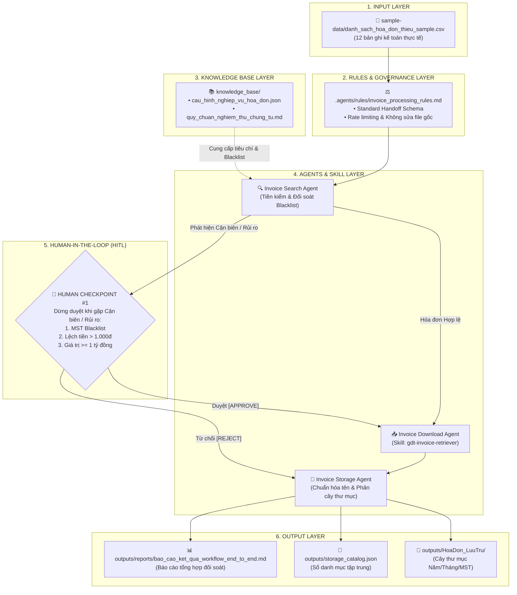

# WORKFLOW SPECIFICATION: END-TO-END INVOICE RETRIEVAL & ARCHIVAL

> **Tên quy trình:** Quy trình Tự động hóa Tìm kiếm, Sắp xếp và Tải Hóa đơn Điện tử Mua vào  
> **Kiến trúc:** OIPO (Origin/Input - Ingestion - Processing - Output) kết hợp 7 Thành tố  
> **Framework:** Google Antigravity Multi-Agent Orchestration  
> **Vị trí file:** `.agents/workflows/invoice_retrieval_workflow.md`

---

## 1. SƠ ĐỒ KẾT NỐI TOÀN DIỆN 7 THÀNH TỐ (WORKFLOW ARCHITECTURE)

---

## 2. NĂM GIAI ĐOẠN VẬN HÀNH END-TO-END

### Giai đoạn 1 — Khởi tạo & Đọc dữ liệu (Input Ingestion)
- Nạp danh sách hóa đơn thiếu từ `sample-data/danh_sach_hoa_don_thieu_sample.csv` với chế độ `dtype=str` để bảo toàn số `0` ở đầu của Mã số thuế và Số hóa đơn.
- Ghi nhận tổng số bản ghi và khởi tạo phiên xử lý (Batch ID).

### Giai đoạn 2 — Áp dụng Rules & Tiền kiểm định dạng
- Áp dụng các quy tắc bắt buộc trong `.agents/rules/invoice_processing_rules.md`:
  - Kiểm tra tính đầy đủ của số hóa đơn (không được rỗng).
  - Kiểm tra độ dài chuẩn của MST: 10 chữ số (doanh nghiệp), 12 chữ số (CCCD hộ kinh doanh), 14 ký tự (chi nhánh).
  - Nếu sai phạm cấu trúc cơ bản $\rightarrow$ Gán cờ `REJECTED` ngay, không đưa vào luồng tra cứu mạng.

### Giai đoạn 3 — Phân tích Nghiệp vụ qua Agent, Skill & Knowledge Base
- Tham chiếu `knowledge_base/cau_hinh_nghiep_vu_hoa_don.json`:
  - Đối chiếu mã số thuế với `tax_risk_blacklist` (Doanh nghiệp ma, bỏ trốn).
  - Kiểm tra tính toán học: $|\text{Tổng thanh toán} - (\text{Chưa thuế} + \text{Thuế})| \le 10$đ.
  - Phân loại mẫu số: Mẫu số 1 (GTGT có mã / không mã CQT) hoặc Mẫu số 2 (Bán hàng trực tiếp).

### Giai đoạn 4 — Điểm kiểm soát con người (Human Checkpoint - HITL)
- **Điều kiện kích hoạt:**
  - Hóa đơn của đơn vị nằm trong Blacklist (ví dụ STT 6 - Cty Ma Xuất Khẩu Khống).
  - Hóa đơn lệch tiền số học (ví dụ STT 7 - Lệch 2 triệu đồng).
  - Hóa đơn cận biên có giá trị lớn $\ge 1.000.000.000$ VNĐ (ví dụ STT 12 - Vinacons 1.32 tỷ đồng).
- **Hành vi hệ thống:**
  - Tạm dừng tiến trình tự động hóa.
  - Hiển thị bảng cảnh báo chi tiết và yêu cầu Kế toán trưởng thẩm định:
    - Nếu chọn `[1] APPROVE`: Cập nhật trạng thái `APPROVED_BY_HUMAN`, bổ sung ghi chú kiểm toán, tiếp tục chuyển sang khâu tải và lưu trữ.
    - Nếu chọn `[2] REJECT`: Đánh dấu `REJECTED_HIGH_RISK`, chặn tải file, cách ly khỏi hồ sơ thuế.

### Giai đoạn 5 — Tải file, Phân loại Cây lưu trữ & Xuất Báo cáo (Output Synchronization)
- Với các hóa đơn hợp lệ và hóa đơn đã được con người duyệt:
  - Skill `gdt-invoice-retriever` tạo bản in PDF sắc nét 1:1 mô phỏng máy in ảo Chromium / Microsoft Print to PDF.
  - Tự động phân loại vào cây thư mục: `outputs/HoaDon_LuuTru/{YYYY}/{MM}/MauSo_{M}/{MST}_{TenNCC}/`.
- Đồng bộ danh mục toàn bộ 12 bản ghi vào `outputs/storage_catalog.json` theo đúng Handoff Schema.
- Soạn thảo Báo cáo đối soát hoàn chỉnh tại `outputs/reports/bao_cao_ket_qua_workflow_end_to_end.md`.
