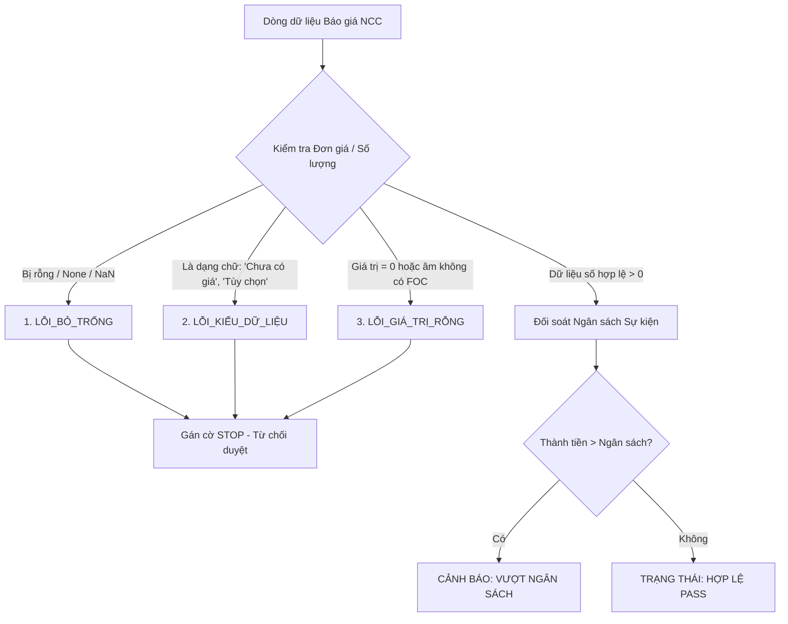
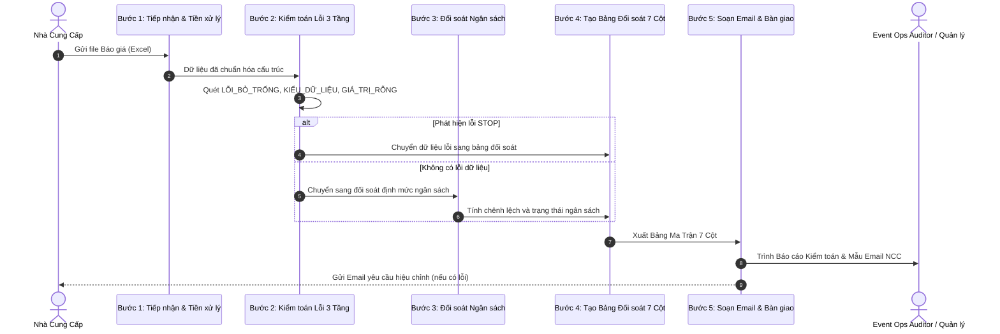

# WORKSPACE SPECIFICATION: Event Quotation Audit & Automation System

> **Hệ thống:** Tự động hóa Đối soát Báo giá Sự kiện (Event Quotation Audit System)  
> **Framework:** SCOPE Framework (Situation - Constraints - Objectives - Process - Evaluation)  
> **Tài liệu tham chiếu:** `Bao_Gia_Chuan.xlsx`, `Bao_Gia_Loi.xlsx`, `Ngan_sach_Su_kien.xlsx`

---

## 1. S - SITUATION (Bối cảnh & Phạm vi Hệ thống)

### 1.1. Bối cảnh Nghiệp vụ (Business Context)
Trong ngành tổ chức sự kiện, mỗi sự kiện quy mô vừa và lớn (hội nghị, gala dinner, lễ ra mắt, hòa nhạc) đều cần làm việc với hàng chục Nhà Cung Cấp (NCC) về âm thanh, ánh sáng, sân khấu, màn hình LED, catering, nhân sự PG/MC, in ấn và quà tặng. 

Hiện tại, quy trình tiếp nhận và kiểm tra báo giá thủ công từ NCC đang gặp phải các vấn đề nghiêm trọng:
- **Tốn thời gian:** Kiểm tra đối soát thủ công bằng Excel mất từ 2 đến 4 giờ cho mỗi sự kiện.
- **Rủi ro sai sót dữ liệu:** Báo giá từ NCC thường xuyên thiếu đơn giá, dùng chữ thay số, hoặc để giá bằng 0 dẫn đến sai lệch dự toán ngân sách.
- **Rủi ro bội chi (Budget Overrun):** Không kịp thời phát hiện các hạng mục báo giá vượt trần ngân sách sự kiện đã duyệt (`Ngan_sach_Su_kien.xlsx`).
- **Phản hồi chậm trễ:** Thời gian trao đổi qua lại với NCC kéo dài làm chậm tiến độ trình duyệt kế hoạch sự kiện lên Ban Giám đốc và Khách hàng.

### 1.2. Phạm vi Ứng dụng (Scope)
- **Đầu vào (Inputs):**
  - File Ngân sách Sự kiện chuẩn: `Ngan_sach_Su_kien.xlsx` (chứa mã hạng mục, định mức chi phí, đơn vị tính).
  - File Báo giá thực tế từ các NCC: Báo giá hợp lệ (`Bao_Gia_Chuan.xlsx`) hoặc Báo giá phát sinh lỗi (`Bao_Gia_Loi.xlsx`).
- **Phạm vi xử lý (In-Scope):** Tự động phân tích cú pháp dữ liệu, kiểm tra 3 nhóm lỗi validation, đối soát chênh lệch chi phí, xuất báo cáo 7 cột và sinh email phản hồi NCC.
- **Phạm vi ngoài (Out-of-Scope):** Quyết định lựa chọn NCC cuối cùng và duyệt chi tài chính ngân hàng (do Event Director và CFO đảm nhiệm).

---

## 2. C - CONSTRAINTS & CATEGORIES (Ràng buộc & 3 Nhóm Lỗi Validation)

Hệ thống thiết lập hàng rào kiểm toán dữ liệu với 3 nhóm lỗi bắt buộc (STOP Errors) khiến báo giá không thể tự động phê duyệt:

### Chi tiết 3 Nhóm Lỗi Validation:

| Mã Loại Lỗi | Tên Loại Lỗi | Định nghĩa & Dấu hiệu Nhận biết | Ví dụ Thực tế trong `Bao_Gia_Loi.xlsx` | Hành vi Xử lý (Constraint) |
| :--- | :--- | :--- | :--- | :--- |
| **ERR-01** | **`LỖI_BỎ_TRỐNG`** | Ô dữ liệu tại cột bắt buộc (`Đơn giá`, `Số lượng`) có giá trị `None`, `null`, `blank`, hoặc khoảng trắng không có dữ liệu. | Dòng 15 (`REQ-014`): Hạng mục "Hộp quà tặng", Số lượng 500, Đơn giá = `None`. | **STOP:** Dừng tính toán thành tiền dòng này; gắn nhãn từ chối; yêu cầu NCC điền đầy đủ. |
| **ERR-02** | **`LỖI_KIỂU_DỮ_LIỆU`** | Cột số lượng/đơn giá chứa ký tự chuỗi văn bản không thể ép kiểu sang kiểu số (`float`/`int`). | - Dòng 6 (`REQ-005`): "Cổng chào hơi", Đơn giá = `"Chưa có giá"` - Dòng 20 (`REQ-019`): "Dọn dẹp sau tiệc", Đơn giá = `"Tùy chọn"` | **STOP:** Dừng tính toán; đánh dấu lỗi định dạng; yêu cầu NCC cung cấp con số cụ thể. |
| **ERR-03** | **`LỖI_GIÁ_TRỊ_RỖNG`** | Đơn giá bằng `0` VNĐ hoặc số âm mà không có ghi chú rõ ràng về quà tặng/tài trợ (`FOC`/`Free`). | Dòng 11 (`REQ-010`): "MC dẫn chương trình", Đơn giá = `0`, Ghi chú = `"Lỗi kịch bản"`. | **STOP:** Đánh dấu nghi vấn giá trị ảo; yêu cầu NCC làm rõ chi phí MC hoặc xác nhận miễn phí. |

---

## 3. O - OBJECTIVES & KPIS (Mục tiêu & Chỉ số Hiệu năng)

Hệ thống kiểm toán tự động cam kết đạt được các chỉ số hiệu năng cụ thể sau:

1. **KPI Thời gian Xử lý (Processing Time):**
   - Thời gian đối soát toàn diện 1 bộ hồ sơ báo giá sự kiện **< 30 phút** (mục tiêu hệ thống tự động: hoàn thành trong **< 30 giây** so với 2-4 giờ xử lý thủ công).
2. **KPI Độ chính xác Kiểm toán (Detection Accuracy):**
   - Phát hiện chính xác **100% (3/3 loại lỗi STOP)** trên tập dữ liệu kiểm thử `Bao_Gia_Loi.xlsx`:
     - $\checkmark$ Phát hiện `LỖI_BỎ_TRỐNG` tại `REQ-014`.
     - $\checkmark$ Phát hiện `LỖI_KIỂU_DỮ_LIỆU` tại `REQ-005` và `REQ-019`.
     - $\checkmark$ Phát hiện `LỖI_GIÁ_TRỊ_RỖNG` tại `REQ-010`.
3. **KPI Đối soát Ngân sách (Budget Variance Tracking):**
   - Khớp nối và đối chiếu 100% hạng mục hợp lệ với `Ngan_sach_Su_kien.xlsx`, gắn cờ cảnh báo chính xác mọi hạng mục vượt ngân sách.
4. **KPI Tự động hóa Giao tiếp (Communication SLA):**
   - 100% báo giá phát hiện lỗi đều tự động tạo sẵn mẫu Email phản hồi gửi NCC với đầy đủ số dòng, mã hạng mục và lỗi chi tiết.

---

## 4. P - PROCESS (Luồng 5 Bước Xử lý Toàn diện)

### Chi tiết 5 Bước Xử Lý:

### Bước 1: Tiếp nhận và Chuẩn hóa Dữ liệu Đầu vào (Ingestion & Normalization)
- Tải file Báo giá NCC (`Bao_Gia_Chuan.xlsx` hoặc `Bao_Gia_Loi.xlsx`) và file Ngân sách chuẩn (`Ngan_sach_Su_kien.xlsx`).
- Chuẩn hóa tên cột: Mã yêu cầu / Mã hạng mục, Tên hạng mục, Đơn vị tính, Số lượng, Đơn giá, Ghi chú.
- Xóa khoảng trắng thừa ở đầu/cuối dữ liệu text (`strip()`).

### Bước 2: Kiểm toán Dữ liệu và Phân Loại Lỗi 3 Tầng (3-Tier Error Tagging)
- Quét từng dòng dữ liệu của Báo giá:
  - **Kiểm tra 1:** Giá trị Đơn giá hoặc Số lượng có bị `None`/rỗng không? $\rightarrow$ Gán `LỖI_BỎ_TRỐNG`.
  - **Kiểm tra 2:** Giá trị Đơn giá/Số lượng có chứa chuỗi văn bản không chuyển đổi thành số được không? $\rightarrow$ Gán `LỖI_KIỂU_DỮ_LIỆU`.
  - **Kiểm tra 3:** Giá trị Đơn giá có $\le 0$ mà không có chú thích FOC không? $\rightarrow$ Gán `LỖI_GIÁ_TRỊ_RỖNG`.
- Phân luồng: Dòng có lỗi được đánh dấu `STOP - TỪ CHỐI`, dòng hợp lệ được tính `Thành tiền = Số lượng * Đơn giá`.

### Bước 3: Đối Soát Chéo Ngân Sách Sự Kiện (Cross-Budget Reconciliation)
- Khớp nối từng dòng báo giá hợp lệ với hạng mục tương ứng trong `Ngan_sach_Su_kien.xlsx`.
- Tính độ lệch ngân sách: $\Delta = \text{Thành tiền Báo giá} - \text{Hạn mức Ngân sách}$.
- Đánh giá trạng thái chi phí:
  - $\Delta \le 0$: `ĐẠT (PASS)` - Tiết kiệm hoặc đúng ngân sách.
  - $\Delta > 0$: `CẢNH BÁO (OVER_BUDGET)` - Vượt ngân sách sự kiện.

### Bước 4: Tạo Bảng Báo Cáo Đối Soát 7 Cột (7-Column Audit Matrix Generation)
- Tổng hợp toàn bộ dữ liệu vào bảng 7 cột tiêu chuẩn:
  1. `Mã yêu cầu / STT`
  2. `Tên hạng mục`
  3. `Số lượng & ĐVT`
  4. `Đơn giá Báo giá (VNĐ)`
  5. `Thành tiền Báo giá (VNĐ)`
  6. `Ngân sách Dự toán (VNĐ)`
  7. `Trạng thái & Loại lỗi / Hành động`

### Bước 5: Soạn Thảo Email Phản Hồi và Lưu Vết Kiểm Toán (Email Drafting & Audit Log)
- Nếu file có lỗi STOP: Tự động trích xuất các dòng vi phạm và tạo dự thảo Email gửi NCC yêu cầu cập nhật bản v2 kèm thời hạn.
- Ghi nhật ký kiểm toán (Audit Trail Log) phục vụ lưu trữ nội bộ và thanh quyết toán sau sự kiện.

---

## 5. E - EVALUATION (Checklist Kiểm Toán Đầu Ra & Tiêu Chuẩn Nghiệm Thu)

Bảng checklist nghiệm thu dành cho Quản lý Vận hành Sự kiện trước khi ký duyệt báo giá:

### 5.1. Checklist Nghiệm Thu Báo Giá (Audit Sign-off Checklist)

| STT | Hạng mục Kiểm tra | Tiêu chuẩn Chấp thuận (Pass Criteria) | Mức độ Rủi ro | Kết quả Đánh giá |
| :---: | :--- | :--- | :---: | :---: |
| 1 | **Kiểm tra Lỗi Bỏ trống** | 100% các ô Số lượng và Đơn giá có dữ liệu, không có ô `None`/Blank. | **CRITICAL** | `[ ] PASS / [ ] FAIL` |
| 2 | **Kiểm tra Kiểu dữ liệu** | 100% cột Đơn giá và Số lượng là số thực dương, không chứa từ khóa text. | **CRITICAL** | `[ ] PASS / [ ] FAIL` |
| 3 | **Kiểm tra Giá trị Bằng 0** | Không có đơn giá bằng 0 trừ khi có xác nhận văn bản là tài trợ/FOC. | **HIGH** | `[ ] PASS / [ ] FAIL` |
| 4 | **Tính chính xác Thành tiền** | Công thức $\text{Thành tiền} = \text{Số lượng} \times \text{Đơn giá}$ khớp chính xác 100%. | **HIGH** | `[ ] PASS / [ ] FAIL` |
| 5 | **Tuân thủ Hạn mức Ngân sách** | Tổng chi phí báo giá nằm trong trần ngân sách sự kiện cho phép. | **MEDIUM** | `[ ] PASS / [ ] FAIL` |
| 6 | **Bảng Báo cáo 7 Cột** | Đầy đủ 7 cột thông tin chuẩn hóa, hiển thị rõ phân loại trạng thái. | **MEDIUM** | `[ ] PASS / [ ] FAIL` |
| 7 | **Dự thảo Email NCC** | Đã sẵn sàng nội dung email chi tiết nêu rõ các dòng cần NCC sửa đổi. | **LOW** | `[ ] PASS / [ ] FAIL` |

### 5.2. Tiêu chuẩn Phê duyệt Cuối cùng (Final Acceptance Protocol)
- **ĐƯỢC PHÊ DUYỆT (ACCEPTED):** Khi và chỉ khi toàn bộ các tiêu chí 1, 2, 3, 4, 5, 6 đều đạt trạng thái `PASS`.
- **YÊU CẦU ĐIỀU CHỈNH (REVISION REQUIRED):** Nếu có bất kỳ tiêu chí nào thuộc mức `CRITICAL` hoặc `HIGH` bị `FAIL`. Tự động chuyển tiếp mẫu Email cho phụ trách mua sắm để gửi NCC trong vòng 15 phút.
