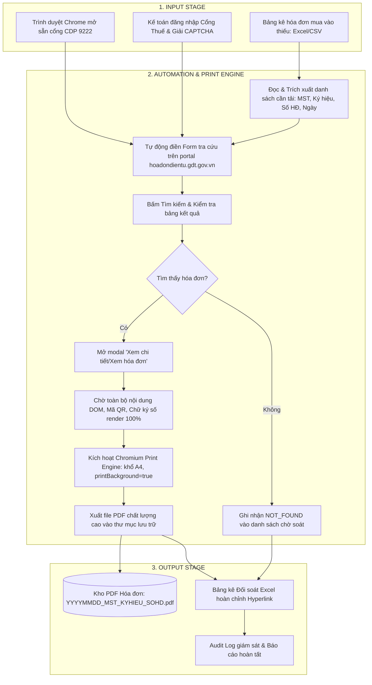

# TÀI LIỆU PHÂN TÍCH ĐỀ BÀI VÀ ĐỀ XUẤT GIẢI PHÁP CHUYỂN ĐỔI SỐ
## HỆ THỐNG TỰ ĐỘNG HÓA TẬP HỢP, TRA CỨU VÀ LƯU TRỮ HÓA ĐƠN ĐIỆN TỬ MUA VÀO (GDT INVOICE AUTOMATION)

> **Đơn vị tư vấn:** Chuyên gia Tư vấn Chuyển đổi số Doanh nghiệp  
> **Khách hàng / Đối tượng áp dụng:** Bộ phận Kế toán - Doanh nghiệp ứng dụng HĐĐT theo Thông tư 78/2021/TT-BTC  
> **Phương pháp luận:** SCOPE Framework (Situation - Constraints - Objectives - Process - Evaluation)  
> **Cơ sở pháp lý & Tiêu chuẩn:** Nghị định 123/2020/NĐ-CP, Thông tư 78/2021/TT-BTC, Luật Kế toán 88/2015/QH13  
> **Ngày lập:** 2026-10-04  
> **Trạng thái:** Bản đề xuất chính thức (Executive Proposal)

---

## TỔNG QUAN DỰ ÁN (EXECUTIVE SUMMARY)

Trong kỷ nguyên hóa đơn điện tử toàn diện theo **Nghị định 123/2020/NĐ-CP**, Cổng thông tin Hóa đơn điện tử của Tổng cục Thuế (`hoadondientu.gdt.gov.vn`) là "nguồn chân lý dữ liệu" (Single Source of Truth) đối với mọi hoạt động mua vào của doanh nghiệp. 

Tuy nhiên, định kỳ hàng tháng/hàng quý, bộ phận Kế toán đang phải đối mặt với một nút thắt cổ chai vận hành nghiêm trọng: **Quy trình thủ công tra cứu, rà soát hóa đơn thiếu sót, tải và lưu trữ từng file hóa đơn PDF**. Thực tế cho thấy:
- Một doanh nghiệp vừa phát sinh từ **200 – 1.000 hóa đơn mua vào/tháng**.
- Kế toán viên phải tiêu tốn từ **15 – 35 giờ công/tháng** chỉ để lặp đi lặp lại chuỗi thao tác: *Đăng nhập Cổng Thuế -> Nhập CAPTCHA -> Lọc ngày -> Nhập MST bên bán -> Nhập số hóa đơn -> Mở xem -> Bấm in PDF -> Đặt tên file -> Lưu vào thư mục máy tính*.
- Nguy cơ tiềm ẩn: Chậm trễ đóng sổ sách kế toán, sai sót dữ liệu, thất lạc file lưu trữ gốc phục vụ quyết toán thuế và đối mặt với rủi ro bị xử phạt hành chính về chứng từ kế toán theo **Nghị định 125/2020/NĐ-CP**.

Dự án **"Hệ thống Tự động hóa Tập hợp, Tra cứu và Lưu trữ Hóa đơn Điện tử Mua vào"** được xây dựng nhằm chuyển đổi số toàn diện mắt xích này thông qua công nghệ **Agentic RPA / Headless Browser Automation kết hợp Cơ chế Máy in ảo Microsoft Print to PDF**, giúp doanh nghiệp:
1. **Tiết kiệm 90% – 95% thời gian** xử lý hóa đơn định kỳ (từ hàng chục giờ xuống còn 10 – 15 phút).
2. **Loại bỏ 100% lỗi thao tác con người** trong việc lưu trữ và đặt tên file.
3. **Bảo toàn 100% tính pháp lý và hình thức hiển thị** của hóa đơn chuẩn A4 phục vụ kiểm tra, thanh tra thuế.

---

## 1. SITUATION (S) — BỐI CẢNH & HIỆN TRẠNG VẬN HÀNH

### 1.1. Bối cảnh tác nghiệp thực tế của Kế toán viên
Hàng tháng, để chuẩn bị lập Tờ khai Thuế GTGT và hạch toán sổ sách chi phí, kế toán viên phải lập **Bảng kê Hóa đơn, Chứng từ Hàng hóa, Dịch vụ Mua vào** (thường xuất từ phần mềm kế toán hoặc bảng quản trị nội bộ Excel). 

Trên thực tế, rất nhiều hóa đơn bên bán gửi chậm, thất lạc email, sai sót địa chỉ hòm thư nhận hóa đơn, hoặc bên bán đã xuất hóa đơn lên Cổng Thuế nhưng kế toán doanh nghiệp chưa nhận được file thể hiện (PDF/XML). Do đó, kế toán bắt buộc phải truy cập trực tiếp vào Cổng `hoadondientu.gdt.gov.vn` để:
1. Đối chiếu danh sách hóa đơn đã ghi nhận với dữ liệu thực tế trên Cổng Tổng cục Thuế.
2. Xác định danh sách các hóa đơn bị thiếu chứng từ gốc (PDF) cần phải thu thập bổ sung.
3. Tìm kiếm từng hóa đơn trên portal, mở ra xem xét tính hợp pháp và xuất file PDF lưu trữ vào kho lưu trữ chứng từ số của công ty.

### 1.2. Phân tích Luồng công việc Hiện tại (AS-IS Workflow)
Quy trình hiện tại bao gồm 8 bước thủ công, lặp đi lặp lại với mức độ phân mảnh cao:

```text
[BƯỚC 1: Lập danh sách thiếu]
Kế toán rà soát Bảng kê mua vào Excel, ghi nhận các hóa đơn thiếu bản PDF lưu trữ.
       │
       ▼
[BƯỚC 2: Đăng nhập Cổng Thuế]
Mở trình duyệt, vào hoadondientu.gdt.gov.vn, nhập MST, Mật khẩu, gõ mã CAPTCHA hình ảnh.
       │
       ▼
[BƯỚC 3: Điều hướng phân hệ]
Bấm "Tra cứu" -> Chọn "Tra cứu hóa đơn" -> Chuyển tab "Hóa đơn điện tử mua vào".
       │
       ▼
[BƯỚC 4: Điền bộ lọc tìm kiếm]
Nhập: Khoảng thời gian (Từ ngày - Đến ngày), MST người bán, Ký hiệu hóa đơn, Số hóa đơn.
       │
       ▼
[BƯỚC 5: Thực hiện Tra cứu]
Bấm "Tìm kiếm", chờ hệ thống phản hồi, tìm dòng dữ liệu khớp trong bảng kết quả.
       │
       ▼
[BƯỚC 6: Mở chi tiết & Chờ Render]
Bấm nút "Xem chi tiết/Xem hóa đơn", chờ popup tải dữ liệu từ CSDL Thuế và hiển thị định dạng web.
       │
       ▼
[BƯỚC 7: In hóa đơn sang PDF thủ công]
Bấm biểu tượng "In hóa đơn" -> Hộp thoại in xuất hiện -> Chọn "Microsoft Print to PDF" ->
Bấm "In/Save" -> Chọn thư mục lưu trữ -> Gõ tên file thủ công (MST_SoHD...).
       │
       ▼
[BƯỚC 8: Đóng popup & Lặp lại]
Đóng popup xem hóa đơn, quay lại Bảng kê Excel đánh dấu "Đã tải", tiếp tục với dòng tiếp theo.
```

### 1.3. Ma trận Điểm nghẽn Vận hành (Baseline Friction & Pain Points)

| Mã số | Điểm nghẽn (Pain Point) | Mô tả chi tiết & Hệ quả thực tế | Mức độ nghiêm trọng |
| :---: | :--- | :--- | :---: |
| **P-01** | **Thời gian hao phí khổng lồ (Time Drain)** | Với 200 hóa đơn cần tải, mỗi hóa đơn mất 2 – 3 phút thao tác bấm chuột và gõ phím. Kế toán mất **6.7 – 10 giờ làm việc liên tục**. Nếu doanh nghiệp lớn (500 – 1.000 HĐ), thời gian mất từ **20 – 35 giờ**, gây quá tải và làm chậm kỳ đóng sổ. | **Cực kỳ cao (Critical)** |
| **P-02** | **Lỗi đặt tên file & Thất lạc dữ liệu** | Đặt tên file thủ công dẫn đến tình trạng gõ nhầm số hóa đơn, sai định dạng ngày tháng, trùng tên file dẫn tới ghi đè mất file cũ. Khi đoàn thanh tra thuế yêu cầu giải trình hóa đơn cụ thể, kế toán mất nhiều giờ để tìm kiếm. | **Cao (High)** |
| **P-03** | **Phiền toái Session Timeout & CAPTCHA** | Cổng Thuế có cơ chế tự động ngắt phiên (Session Timeout sau 15 – 30 phút không hoạt động hoặc tải nhiều request). Kế toán bị out đột ngột, phải đăng nhập lại từ đầu, làm đứt gãy mạch làm việc. | **Trung bình (Medium)** |
| **P-04** | **Lỗi vỡ layout / Thiếu stylesheet** | Nếu tải trực tiếp file HTM/XML thô về rồi chuyển đổi bằng các tool trôi nổi bên thứ ba, hóa đơn thường bị lỗi font chữ Tiếng Việt, vỡ khung viền hoa văn, mất logo/watermark Trống đồng và thiếu khung hiển thị chữ ký số hợp lệ. | **Cao (High)** |
| **P-05** | **Rủi ro Pháp lý & Phạt hành chính** | Theo Nghị định 125/2020/NĐ-CP, việc làm mất, thất lạc hoặc không lưu trữ chứng từ kế toán điện tử hợp lệ có thể bị phạt tiền từ **4.000.000 đ đến 10.000.000 đ/hành vi**. Thiếu hóa đơn gốc dẫn tới nguy cơ bị loại trừ chi phí được trừ khi tính thuế TNDN. | **Cực kỳ cao (Critical)** |

---

## 2. CONSTRAINTS (C) — RÀNG BUỘC KỸ THUẬT, PHÁP LÝ & BẢO MẬT

Để một giải pháp tự động hóa có thể ứng dụng an toàn và ổn định trong môi trường doanh nghiệp, hệ thống bắt buộc phải giải quyết triệt để các rào cản và ràng buộc cốt lõi sau:

### 2.1. Ràng buộc Kỹ thuật & Hạ tầng Cổng Tổng cục Thuế
1. **Cơ chế xác thực CAPTCHA & Chống bot:**  
   Cổng `hoadondientu.gdt.gov.vn` sử dụng cơ chế bảo mật hình ảnh CAPTCHA để chống tấn công tự động (DDoS, Scraping).  
   *Giải pháp kiểm soát:* Không sử dụng các dịch vụ bẻ khóa CAPTCHA bất hợp pháp. Áp dụng mô hình **Human-in-the-loop (Human Checkpoint)**: Kế toán viên tự thực hiện đăng nhập và giải mã CAPTCHA 1 lần đầu tiên trên trình duyệt chuyên dụng có mở cổng kết nối tự động (`CDP Port 9222`).
2. **Tính bất ổn định của đường truyền mạng Thuế:**  
   Vào những ngày cao điểm (ngày 20 hàng tháng hoặc ngày 30 của quý), Cổng Thuế thường xảy ra tình trạng phản hồi chậm, nghẽn mạng hoặc trả về lỗi 502/504.  
   *Giải pháp kiểm soát:* Hệ thống tự động hóa phải có cơ chế **Retry logic, Backoff delay** và ghi nhận log chi tiết đối với từng hóa đơn không tải được để xử lý lại (Failed Retry Queue).

### 2.2. Ràng buộc Pháp lý & Khuôn mẫu Hóa đơn (Nghị định 123 & Thông tư 78)
1. **Bảo toàn dữ liệu 100%:**  
   Hệ thống tuyệt đối **không được chỉnh sửa, làm tròn số học, thêm/bớt** bất kỳ ký tự nào trên nội dung hóa đơn (MST, Tên nhà cung cấp, Ngày ký, Mặt hàng, Đơn giá, Thành tiền, Thuế suất, Tổng thanh toán, Tiền chữ, Mã cơ quan thuế MCCQT).
2. **Khuôn mẫu in ấn chuẩn mực A4 (Print Media Standard):**  
   File PDF tạo ra phải đạt tiêu chuẩn in ấn lưu trữ chứng từ kế toán:
   - Khổ giấy: `A4 Portrait` (Dọc).
   - Khung viền: Hoa văn đôi vàng hoàng gia (`#b3882a`).
   - Nền chìm: Họa tiết Trống đồng Đông Sơn và hoa văn văn hóa Việt Nam.
   - Khối nhận diện: Mã QR Code xác thực ở góc trên bên trái, Mã số/Ký hiệu/Số hóa đơn góc trên bên phải.
   - Khung Chữ ký số điện tử: Khung viền xanh lá thể hiện tính toàn vẹn `Signature Valid`, ngày ký, giờ ký rõ ràng.
3. **Cơ chế Máy in ảo (Chromium Print Engine / Microsoft Print to PDF):**  
   Bắt buộc sử dụng cơ chế render thông qua `@media print` của trình duyệt để kết xuất ra PDF vector độ nét cao, không bị vỡ ảnh hay méo chữ như các phần mềm chụp màn hình.

### 2.3. Ràng buộc An toàn Thông tin & Bảo mật Doanh nghiệp
1. **Tuân thủ Nguyên tắc Xử lý Nội bộ (On-Premises / Local Privacy):**  
   Tài khoản đăng nhập thuế, dữ liệu chi tiêu và thông tin nhà cung cấp là bí mật kinh doanh tối mật. Hệ thống tự động hóa phải chạy **100% cục bộ trên máy tính của kế toán viên** (Local Execution), không gửi dữ liệu hóa đơn, mật khẩu hay tài khoản lên máy chủ trung gian của bên thứ ba.
2. **Bảo toàn nhật ký kiểm toán (Audit Trail):**  
   Mọi hành động tra cứu, thời gian tải, kết quả thành công/thất bại phải được ghi nhận vào file log minh bạch để phục vụ công tác kiểm tra chéo nội bộ.

---

## 3. OBJECTIVES (O) — MỤC TIÊU ĐỊNH LƯỢNG & ĐẦU RA (SMART GOALS)

Hệ thống được thiết kế hướng tới việc chuyển đổi toàn bộ gánh nặng thao tác cơ học thành quy trình số hóa chuẩn mực, đạt được các chỉ tiêu SMART cụ thể:

### 3.1. Mục tiêu Định lượng (Measurable KPIs)

```text
┌──────────────────────────────┬───────────────────┬───────────────────┬─────────────────────┐
│ Chỉ số đo lường (KPI)        │ Hiện trạng (AS-IS)│ Mục tiêu (TO-BE)  │ Mức độ cải thiện    │
├──────────────────────────────┼───────────────────┼───────────────────┼─────────────────────┤
│ Thời gian tải 200 hóa đơn    │ 600 - 900 phút    │ 10 - 15 phút      │ Giảm 97.5% thời gian│
│ Tốc độ xử lý trung bình/HĐ   │ 120 - 180 giây/HĐ │ 3 - 5 giây/HĐ     │ Nhanh gấp 30-40 lần │
│ Tỷ lệ chính xác tên file     │ ~92% (có sai sót) │ 100% tuyệt đối    │ Loại bỏ 100% lỗi gõ │
│ Tỷ lệ bỏ sót hóa đơn         │ 3% - 5% kỳ cao điểm│ 0% (đối soát tự động) Đảm bảo toàn vẹn      │
│ Khả năng in ấn chuẩn A4 PDF  │ Phụ thuộc tay ấn  │ 100% chuẩn vector │ Đạt chuẩn thanh tra │
└──────────────────────────────┴───────────────────┴───────────────────┴─────────────────────┘
```

### 3.2. Đầu ra Chuẩn mực của Dự án (Expected Deliverable Artifacts)
1. **Bộ file PDF Hóa đơn chuẩn hóa (`outputs/invoices/YYYY-MM/`):**  
   Toàn bộ hóa đơn được tải về dưới dạng file PDF sắc nét, đúng chuẩn mẫu hiển thị của Tổng cục Thuế.  
   Quy tắc đặt tên file tự động thống nhất:
   ```text
   YYYYMMDD_MST_KYHIEU_SOHOADON.pdf
   Ví dụ: 20260701_0100100417-069_K26TBP_0300256.pdf
   ```
2. **Báo cáo Đối soát Hóa đơn Tự động (`outputs/reports/Reconciliation_Report_YYYYMM.xlsx`):**  
   Bảng tổng hợp chi tiết trạng thái từng hóa đơn trong Bảng kê đầu vào:
   - Cột trạng thái: `SUCCESS` (Đã tải thành công), `NOT_FOUND` (Không tìm thấy trên Cổng Thuế), `FAILED` (Lỗi mạng/Cần rà soát).
   - Đường dẫn liên kết trực tiếp (Hyperlink) mở ngay file PDF vừa tải.
   - Thống kê tổng tiền trước thuế, tiền thuế GTGT và tổng thanh toán của các hóa đơn đã thu thập.
3. **Nhật ký Giám sát Vận hành (`outputs/logs/invoice_sync_audit.log`):**  
   Lưu vết từng request, mã HTTP, thời gian hoàn tất, danh sách lỗi phát sinh để kế toán trưởng dễ dàng hậu kiểm.

---

## 4. PROCESS (P / OIPO) — THIẾT KẾ QUY TRÌNH TỰ ĐỘNG HÓA & KIẾN TRÚC GIẢI PHÁP

### 4.1. Ma trận Đánh giá & Lựa chọn Phương án Công nghệ (Trade-off Matrix)

Là Chuyên gia Tư vấn Chuyển đổi số, chúng tôi đặt lên bàn cân 3 phương án khả thi để Ban Lãnh đạo và Kế toán trưởng thẩm định:

| Tiêu chí so sánh | Phương án 1: Mua phần mềm đóng gói / Cổng dịch vụ ngoài | Phương án 2: Script Macro / Extension trình duyệt đơn giản | Phương án 3: Agentic RPA qua CDP & Virtual Print Engine (ĐỀ XUẤT) |
| :--- | :--- | :--- | :--- |
| **Bản chất công nghệ** | Thuê bao phần mềm Cloud (SaaS) của các nhà cung cấp trung gian. | Dùng add-on Chrome hoặc script AutoHotkey/iMacros mô phỏng chuột. | Tận dụng Chrome DevTools Protocol (CDP port 9222) + Headless Print API + Agentic Controller. |
| **Bảo mật dữ liệu** | Rủi ro cao: Phải bàn giao tài khoản Cổng Thuế cho server bên thứ ba lưu trữ. | Trung bình: Dễ bị rò rỉ qua extension không được kiểm duyệt. | **Tuyệt đối an toàn: 100% Local trên máy kế toán, người dùng tự gõ mật khẩu & CAPTCHA.** |
| **Độ ổn định & Thích ứng** | Phụ thuộc vào server bên thứ ba; khi Cổng Thuế đổi giao diện thường bị tê liệt nhiều ngày. | Rất kém: Chỉ cần màn hình đổi vị trí nút hoặc mạng lag là script bị click trượt. | **Rất cao: Tự động bắt đúng DOM element, chờ render dữ liệu mới kích hoạt lệnh in.** |
| **Chất lượng file PDF** | Thường chỉ kéo dữ liệu XML rồi render lại bằng mẫu chung (dễ sai khác mẫu gốc). | Chụp màn hình (Screenshot) -> mờ, vỡ nét, không đủ trang khi hóa đơn dài nhiều trang. | **Xuất sắc 100%: Sử dụng chính Chromium Print Engine để xuất bản in A4 chuẩn theo quy tắc @media print gốc.** |
| **Chi phí đầu tư** | Tốn kém chi phí bản quyền hàng năm (từ 5 – 20 triệu/năm tùy lượng HĐ). | Miễn phí nhưng chi phí sửa lỗi vận hành và rủi ro quá lớn. | **Chi phí bản quyền = 0 VNĐ (Tận dụng hạ tầng Chrome & Python sẵn có của doanh nghiệp).** |
| **ĐÁNH GIÁ CHUNG** | Cồng kềnh, lo ngại rủi ro bảo mật tài khoản Thuế. | Nghiệp dư, không dùng được cho môi trường chuyên nghiệp. | **LỰA CHỌN TỐI ƯU NHẤT (Khuyến nghị áp dụng ngay).** |

### 4.2. Kiến trúc Quy trình TO-BE chuẩn OIPO (Objective - Input - Process - Output)

Hệ thống vận hành theo chu trình 4 pha khép kín:



### 4.3. Mô tả Chi tiết 4 Bước Tác nghiệp Tự động

1. **Bước 1 — Khởi tạo an toàn (Safe Initialization):**
   - Kế toán chỉ cần kích hoạt file batch khởi động nhanh (`Mo_Chrome_Tu_Dong.bat`).
   - Chrome khởi động độc lập với hồ sơ dữ liệu an toàn (`--remote-debugging-port=9222`).
   - Kế toán thực hiện đăng nhập và gõ CAPTCHA trên Cổng Thuế như thường lệ (Đảm bảo an toàn tài khoản).
2. **Bước 2 — Nạp dữ liệu & Tra cứu hàng loạt (Batch Ingestion & Automation):**
   - Script đọc file Bảng kê đầu vào (ví dụ: `Tung yang thieu HD vao thang 7-2026.xlsx`).
   - Hệ thống tự động phân tích và lọc ra danh sách các hóa đơn chưa có file PDF.
   - Tự động điền các trường: MST Người bán (`#nbmst`), Ký hiệu (`#khhdon`), Số hóa đơn (`#shdon`), Ngày lập và kích hoạt tìm kiếm.
3. **Bước 3 — Render & Xuất PDF qua Máy in ảo (Native Print-to-PDF):**
   - Khi dòng hóa đơn xuất hiện, hệ thống click chọn và mở màn hình "Xem chi tiết".
   - Thuật toán thông minh chờ đợi toàn bộ stylesheet, hình nền Trống đồng và khối xác thực chữ ký điện tử tải xong 100%.
   - Kích hoạt giao thức in PDF trực tiếp từ trình duyệt (`Page.printToPDF`) với tham số cấu hình: Khổ giấy A4, hướng dọc, căn lề chuẩn 8mm/6mm, hiển thị toàn bộ background graphics.
4. **Bước 4 — Đặt tên chuẩn & Xuất Báo cáo đối soát (Indexing & Reconciliation):**
   - Lưu file theo quy tắc `YYYYMMDD_MST_KYHIEU_SOHOADON.pdf`.
   - Cập nhật kết quả vào file Excel Báo cáo đối soát kèm đường link bấm vào là mở trực tiếp hóa đơn PDF để kiểm tra tức thì.

---

## 5. EVALUATION (E) — TIÊU CHUẨN NGHIỆM THU & BỘ CHỈ SỐ KPI

Để dự án được nghiệm thu và đưa vào vận hành chính thức, hệ thống phải vượt qua bảng kiểm định chất lượng (Acceptance Criteria) với 4 trụ cột chính:

### 5.1. Bảng Tiêu chí Nghiệm thu (Acceptance Criteria Checklist)

| Trụ cột | STT | Tiêu chí nghiệm thu cụ thể | Phương pháp kiểm tra / Bằng chứng | Kết quả yêu cầu |
| :--- | :---: | :--- | :--- | :---: |
| **Tính năng (Functional)** | E-01 | Tự động đọc và xử lý danh sách hóa đơn từ file Excel bảng kê mẫu doanh nghiệp. | Chạy thử nghiệm trên file bảng kê thực tế (ví dụ: `Tung yang thieu HD vao thang 7-2026.xlsx`). | Đạt 100% |
| | E-02 | Tự động điền form và tìm kiếm chính xác từng hóa đơn trên Cổng Thuế qua CDP. | Quan sát màn hình Chrome hoạt động tự động khi chạy bot. | Đạt 100% |
| | E-03 | Tự động mở xem hóa đơn, bắt đúng thời điểm render xong chữ ký số. | Kiểm tra modal popup mở và đóng đúng nhịp, không bị treo. | Đạt 100% |
| | E-04 | Đặt tên file PDF theo đúng quy chuẩn `YYYYMMDD_MST_KYHIEU_SOHOADON.pdf`. | Kiểm tra danh sách file trong thư mục lưu trữ đầu ra. | Khớp 100% |
| **Chất lượng (Quality)** | E-05 | File PDF tạo ra đạt chuẩn hiển thị A4, giữ nguyên hoa văn Trống đồng, khung vàng, QR Code. | Mở đối chiếu trực quan file PDF in ra với mẫu tham chiếu `knowledge-base/hd1.pdf`. | Chuẩn 1:1 |
| | E-06 | Dữ liệu trên file PDF hoàn toàn trùng khớp với dữ liệu gốc của CQT, không bị cắt xén. | So khớp số tiền, thuế suất, tên hàng hóa giữa PDF và dữ liệu web. | Khớp tuyệt đối |
| **Hiệu năng (Performance)**| E-07 | Tốc độ tải và xuất file PDF trung bình đạt từ 3 – 5 giây/hóa đơn. | Đo thời gian xử lý mẻ 20 – 50 hóa đơn bằng file log. | < 5s / HĐ |
| | E-08 | Hệ thống có cơ chế xử lý ngoại lệ: Ghi nhận `NOT_FOUND` và tiếp tục chạy hóa đơn sau mà không bị sập. | Kiểm thử với 3 hóa đơn sai số hoặc không tồn tại trên portal. | Không gián đoạn |
| **Báo cáo & Kiểm soát**| E-09 | Xuất file Excel Báo cáo đối soát tổng hợp đầy đủ số lượng thành công, thất bại và link mở file. | Mở file `Reconciliation_Report.xlsx`, click vào hyperlink kiểm tra tính mở file. | Mở mượt mà |
| | E-10 | Không lưu trữ hay làm rò rỉ thông tin bảo mật, tài khoản thuế ra internet. | Kiểm tra mã nguồn và đường truyền mạng (Network inspection). | 100% Local |

### 5.2. Kế hoạch Triển khai Thử nghiệm (Pilot Test Plan)
- **Giai đoạn 1 (Tuần 1):** Kiểm thử môi trường nội bộ với 10 hóa đơn đại diện từ các nhà cung cấp phổ biến (Điện lực, Nước sạch, Viễn thông, Dịch vụ vận tải).
- **Giai đoạn 2 (Tuần 2):** Chạy thử nghiệm thực tế trên toàn bộ danh sách hóa đơn thiếu tháng 07/2026 của Công ty TNHH Tung Yang.
- **Giai đoạn 3 (Tuần 3):** Đánh giá độ ổn định, hoàn thiện tài liệu hướng dẫn vận hành 1-click cho kế toán viên.
- **Giai đoạn 4 (Tuần 4):** Bàn giao chính thức và đưa vào quy trình đóng sổ định kỳ hàng tháng.

---

## 6. OUT OF SCOPE (NON-GOALS) — CÁC YẾU TỐ NGOÀI PHẠM VI DỰ ÁN

Để dự án tập trung tối đa nguồn lực vào giải quyết triệt để bài toán cốt lõi, tránh dàn trải và rủi ro kỹ thuật, các hạng mục sau được xác định rõ ràng là **Ngoài phạm vi (Non-goals)** của giai đoạn này:

1. **Không tự động hóa bẻ khóa CAPTCHA (Bypass CAPTCHA):**  
   Hệ thống không sử dụng các dịch vụ OCR bẻ khóa CAPTCHA bên ngoài để tránh vi phạm chính sách bảo mật của Tổng cục Thuế và nguy cơ bị khóa tài khoản/chặn IP. Kế toán viên đảm nhiệm bước đăng nhập này (Human Checkpoint chỉ mất 15 giây).
2. **Không can thiệp hoặc chỉnh sửa nội dung hóa đơn:**  
   Hệ thống chỉ làm nhiệm vụ thu thập, in ấn nguyên bản và lưu trữ. Không có tính năng can thiệp chỉnh sửa dữ liệu số học của hóa đơn.
3. **Không tự động lập hoặc nộp Tờ khai Thuế GTGT lên CQT:**  
   Hệ thống dừng lại ở việc cung cấp hồ sơ hóa đơn PDF sạch và bảng đối soát để kế toán viên chủ động lập tờ khai trên phần mềm kế toán (MISA, FAST, Bravo, SAP...).
4. **Không thay thế hoàn toàn phần mềm lưu trữ chứng từ chuyên dụng (EDM Enterprise):**  
   Hệ thống đóng vai trò là "Cầu nối tự động hóa thu thập dữ liệu" (Data Acquisition & RPA Bridge), tổ chức lưu trữ theo cấu trúc thư mục tiêu chuẩn trên ổ đĩa máy tính hoặc mạng nội bộ của doanh nghiệp.

---

## 7. ĐÁNH GIÁ TÁC ĐỘNG & BÀI TOÁN KINH TẾ (BUSINESS CASE & ROI)

### 7.1. Phân tích Chi phí vs Lợi ích (Cost-Benefit Analysis)

Giả định mô hình tại một doanh nghiệp có quy mô trung bình (khoảng **300 hóa đơn mua vào/tháng**):

```text
┌──────────────────────────────────────┬────────────────────────────┬────────────────────────────┐
│ Hạng mục phân tích                   │ Phương án Thủ công (Cũ)    │ Áp dụng Giải pháp RPA (Mới)│
├──────────────────────────────────────┼────────────────────────────┼────────────────────────────┤
│ Thời gian kế toán xử lý / tháng      │ 15 giờ / tháng             │ 0.5 giờ / tháng            │
│ Thời gian kế toán xử lý / năm        │ 180 giờ / năm              │ 6 giờ / năm                │
│ Chi phí nhân sự hao phí (100k/giờ)   │ 18.000.000 VNĐ / năm       │ 600.000 VNĐ / năm          │
│ Nguy cơ phạt thuế chậm chứng từ      │ 4.000.000 - 10.000.000 VNĐ │ 0 VNĐ (Không bao giờ trễ)  │
│ Chi phí đầu tư bản quyền phần mềm    │ 0 VNĐ                      │ 0 VNĐ (Giải pháp nội bộ)   │
├──────────────────────────────────────┼────────────────────────────┼────────────────────────────┤
│ TỔNG LỢI ÍCH TIẾT KIỆM HÀNG NĂM      │ ────                       │ > 25.000.000 VNĐ / NĂM     │
│ TỶ LỆ HOÀN VỐN ĐẦU TƯ (ROI)          │ ────                       │ > 1.200% (Hoàn vốn ngay M1)│
└──────────────────────────────────────┴────────────────────────────┴────────────────────────────┘
```

### 7.2. Giá trị Gia tăng Vô hình (Intangible Strategic Benefits)
1. **Giải phóng nhân sự kế toán khỏi công việc sự vụ lặp lại:** Kế toán viên dành thời gian cho công tác phân tích chi phí, tối ưu dòng tiền và quản trị tài chính doanh nghiệp thay vì làm "thợ bấm chuột".
2. **Sẵn sàng tuyệt đối cho Thanh tra - Quyết toán Thuế:** Khi cơ quan thuế yêu cầu kiểm tra bất kỳ hóa đơn nào, chỉ cần 1 click trên Bảng kê là mở được ngay bản in PDF chuẩn chỉ có chữ ký số điện tử hợp lệ, xây dựng hình ảnh chuyên nghiệp và minh bạch cho doanh nghiệp.
3. **Bước đệm vững chắc cho Chiến lược Chuyển đổi số toàn diện:** Dự án là minh chứng thực tế rõ ràng nhất cho thấy công nghệ Agentic AI và Tự động hóa có thể tạo ra giá trị tức thì, thúc đẩy tinh thần đổi mới sáng tạo trong toàn công ty.

---
*Tài liệu được biên soạn và bảo trợ chuyên môn bởi Chuyên gia Tư vấn Chuyển đổi số Doanh nghiệp.*
