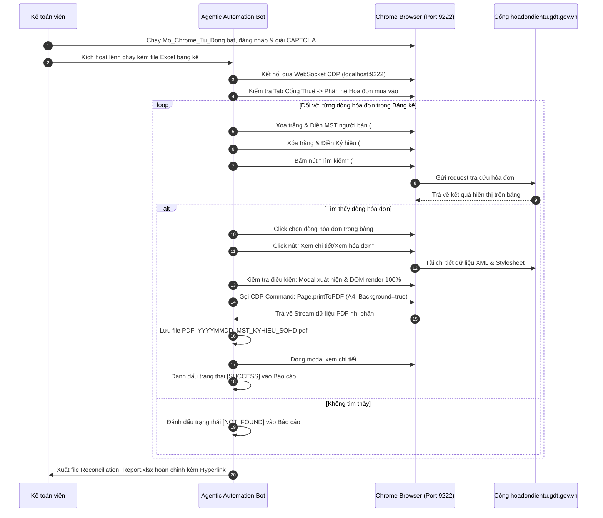

# TÀI LIỆU ĐẶC TẢ QUY TRÌNH VẬN HÀNH OIPO & CƠ CHẾ KỸ THUẬT
## HỆ THỐNG TỰ ĐỘNG HÓA TRA CỨU & XUẤT HÓA ĐƠN PDF TỪ CỔNG THUẾ (GDT PORTAL)

> **Mô hình kiến trúc:** OIPO (Objective - Input - Process - Output)  
> **Giao thức điều khiển:** Chrome DevTools Protocol (CDP - Remote Debugging Port 9222)  
> **Cơ chế in ấn:** Chromium Native Print Engine / Microsoft Print to PDF (`Page.printToPDF`)  
> **Đơn vị phát triển:** Giải pháp Agentic RPA nội bộ doanh nghiệp

---

## 1. MÔ HÌNH KIẾN TRÚC OIPO TỔNG THỂ

```text
┌────────────────────────────────────────────────────────────────────────────────────────┐
│ 1. OBJECTIVE (MỤC TIÊU NGHIỆP VỤ)                                                      │
│    • Thu thập 100% hóa đơn điện tử mua vào còn thiếu trên Cổng Tổng cục Thuế.          │
│    • Kết xuất bản in PDF chất lượng cao khổ A4, bảo toàn 100% chữ ký số & watermark.  │
│    • Tự động đối soát bảng kê và lưu trữ khoa học phục vụ quyết toán thuế.            │
└────────────────────────────────────────────────────────────────────────────────────────┘
                                            │
                                            ▼
┌────────────────────────────────────────────────────────────────────────────────────────┐
│ 2. INPUT (DỮ LIỆU ĐẦU VÀO)                                                             │
│    • File Bảng kê hóa đơn mua vào thiếu (Excel .xlsx hoặc CSV).                        │
│    • Các trường thông tin khóa: [Ký hiệu HĐ], [Số HĐ], [MST Người bán], [Ngày HĐ].     │
│    • Trình duyệt Chrome đã kích hoạt cổng 9222 và đăng nhập phiên Cổng Thuế.          │
└────────────────────────────────────────────────────────────────────────────────────────┘
                                            │
                                            ▼
┌────────────────────────────────────────────────────────────────────────────────────────┐
│ 3. PROCESS (QUY TRÌNH XỬ LÝ 4 GIAI ĐOẠN)                                               │
│    • Giai đoạn 1: Chuẩn hóa dữ liệu đầu vào & Lọc trùng lặp.                           │
│    • Giai đoạn 2: Tự động điều hướng & Tra cứu qua giao thức CDP.                      │
│    • Giai đoạn 3: Bắt điểm chờ Render DOM & Kích hoạt Chromium Print Engine.           │
│    • Giai đoạn 4: Đổi tên file chuẩn, lưu trữ thư mục & Ghi nhận log đối soát.         │
└────────────────────────────────────────────────────────────────────────────────────────┘
                                            │
                                            ▼
┌────────────────────────────────────────────────────────────────────────────────────────┐
│ 4. OUTPUT (SẢN PHẨM ĐẦU RA)                                                            │
│    • Thư mục chứa các file PDF chuẩn hóa: YYYYMMDD_MST_KYHIEU_SOHOADON.pdf.           │
│    • Bảng kê đối soát Excel (Reconciliation Report) tích hợp Hyperlink mở nhanh file.  │
│    • File Audit Trail Log ghi nhận nhật ký vận hành chi tiết.                          │
└────────────────────────────────────────────────────────────────────────────────────────┘
```

---

## 2. CHI TIẾT CÁC THÀNH PHẦN OIPO

### 2.1. Objective (Mục tiêu)
- **Tốc độ xử lý:** Đạt từ 3 – 5 giây cho mỗi hóa đơn.
- **Tính toàn vẹn pháp lý:** Hóa đơn PDF xuất ra phải giữ nguyên 100% định dạng `@media print` của Tổng cục Thuế:
  - Khung viền hoa văn vàng hoàng gia (`#b3882a`).
  - Họa tiết nền chìm Trống đồng Đông Sơn.
  - Khối mã QR Code kiểm tra hóa đơn.
  - Khung hiển thị xác thực chữ ký điện tử (`Signature Valid`).
- **An toàn vận hành:** Không bị chặn IP hoặc khóa tài khoản do tôn trọng cơ chế Human Checkpoint đăng nhập của CQT.

### 2.2. Input (Đầu vào)
Hệ thống chấp nhận các định dạng bảng kê quản trị chuẩn của kế toán doanh nghiệp (tương thích mẫu bảng kê từ MISA, FAST, Bravo, Excel nội bộ):
- **Cấu trúc trường thông tin bắt buộc:**
  1. `Ký hiệu HĐ` (KHHDon): Chuỗi ký tự định danh mẫu hóa đơn (ví dụ: `K26TBP`, `K26TNS`, `1C26TBB`).
  2. `Số hóa đơn` (SHDon): Chuỗi số hóa đơn (ví dụ: `300256`, `0350471`). Tự động xử lý tiền tố số 0 (zfill).
  3. `Mã số thuế người bán` (NBMST): Mã số thuế bên bán (ví dụ: `0100100417-069`, `0800001348`).
  4. `Ngày hóa đơn` (NgayHD): Định dạng ngày tháng năm lập hóa đơn (ví dụ: `2026-07-01` hoặc `01/07/2026`).

---

## 3. CƠ CHẾ KỸ THUẬT VẬN HÀNH (PROCESS DEEP DIVE)

### 3.1. Cơ chế Khởi động & Kết nối Trình duyệt qua CDP (Port 9222)
Thay vì sử dụng các thư viện WebDriver nặng nề dễ bị Cổng Thuế phát hiện là bot tự động (Selenium thường để lộ cờ `navigator.webdriver = true`), hệ thống kết nối trực tiếp vào trình duyệt Google Chrome chính chủ của người dùng qua giao thức **Chrome DevTools Protocol (CDP)**:

1. **Khởi động Chrome độc lập:**
   ```bat
   chrome.exe --remote-debugging-port=9222 --user-data-dir="C:\ChromeDebug" "https://hoadondientu.gdt.gov.vn"
   ```
2. **Ưu điểm vượt trội:**
   - **Hoàn toàn tàng hình đối với hệ thống chống bot:** Trình duyệt chạy với đầy đủ profile, cookie, fingerprint của người dùng thật.
   - **Tách biệt dữ liệu:** Thư mục dữ liệu người dùng tạm thời `C:\ChromeDebug` giữ cho phiên làm việc sạch sẽ, không ảnh hưởng đến trình duyệt cá nhân đang mở.
   - **Tương tác linh hoạt:** Người dùng có thể trực tiếp quan sát bot thao tác trên màn hình hoặc thu nhỏ cửa sổ để làm việc khác.

### 3.2. Cơ chế Điều hướng & Tra cứu Chính xác



### 3.3. Cơ chế Render & Xuất PDF Đạt Chuẩn 1:1 qua Chromium Print Engine

Khác biệt cốt lõi giữa hệ thống này và các công cụ chụp màn hình là việc áp dụng lệnh nội tại của trình duyệt: **`Page.printToPDF`**.

**Bảng Tham số Cấu hình In Chuẩn A4:**
```json
{
  "landscape": false,
  "displayHeaderFooter": false,
  "printBackground": true,
  "preferCSSPageSize": true,
  "paperWidth": 8.27,
  "paperHeight": 11.69,
  "marginTop": 0.315,
  "marginBottom": 0.315,
  "marginLeft": 0.236,
  "marginRight": 0.236,
  "scale": 1.0
}
```

**Lợi ích của bộ tham số:**
- `printBackground = true`: Bắt buộc để máy in ảo vẽ đầy đủ các hoa văn Trống đồng chìm, màu sắc tiêu đề bảng biểu và con dấu chữ ký số điện tử.
- `paperWidth = 8.27`, `paperHeight = 11.69`: Quy chuẩn kích thước vật lý chính xác của khổ giấy `A4` theo tiêu chuẩn quốc tế ISO 216.
- `scale = 1.0`: Giữ nguyên tỷ lệ 100%, chống hiện tượng méo chữ, tràn viền hoặc co cụm nội dung.

---

## 4. CHI TIẾT SẢN PHẨM ĐẦU RA (OUTPUT STANDARDS)

### 4.1. Quy chuẩn Đặt tên File Lưu trữ (Naming Convention)
Mỗi hóa đơn PDF khi xuất thành công phải được lưu theo quy tắc định danh duy nhất:

```text
YYYYMMDD_MST_KYHIEU_SOHOADON.pdf
```
- `YYYYMMDD`: Năm - Tháng - Ngày lập hóa đơn (ví dụ: `20260701`).
- `MST`: Mã số thuế của người bán, giữ nguyên dấu gạch nối chi nhánh nếu có (ví dụ: `0100100417-069`).
- `KYHIEU`: Ký hiệu mẫu hóa đơn viết hoa, không khoảng trắng (ví dụ: `K26TBP`).
- `SOHOADON`: Số hóa đơn chuẩn hóa 7 chữ số (ví dụ: `0300256`).

*Ví dụ hoàn chỉnh:* `20260701_0100100417-069_K26TBP_0300256.pdf`

### 4.2. Báo cáo Đối soát Hóa đơn Excel (Reconciliation Report)
File Excel tổng kết sau khi chạy xong bao gồm các cột nghiệp vụ quan trọng:

| Cột | Tên trường | Ý nghĩa nghiệp vụ |
| :---: | :--- | :--- |
| **A** | STT | Số thứ tự hóa đơn trong danh sách cần đối soát. |
| **B** | Ngày hóa đơn | Ngày lập hóa đơn theo bảng kê mua vào. |
| **C** | Ký hiệu HĐ | Ký hiệu hóa đơn bên bán. |
| **D** | Số hóa đơn | Số thứ tự hóa đơn bên bán phát hành. |
| **E** | Mã số thuế bên bán | Mã số thuế đơn vị cung cấp hàng hóa/dịch vụ. |
| **F** | Tên bên bán | Tên công ty/chi nhánh nhà cung cấp. |
| **G** | Trạng thái đối soát | `SUCCESS` (Thành công) hoặc `NOT_FOUND` (Không thấy trên portal). |
| **H** | Đường dẫn file PDF | **Hyperlink động**: Bấm vào mở trực tiếp file PDF trên máy tính. |
| **I** | Ghi chú kiểm toán | Thời gian xử lý, mã phản hồi hoặc cảnh báo cần kiểm tra lại. |

---

## 5. HƯỚNG DẪN XỬ LÝ NGOẠI LỆ & BẢO TRÌ HỆ THỐNG

| Tình huống ngoại lệ | Nguyên nhân thực tế | Quy trình xử lý tự động & Khuyến nghị kế toán |
| :--- | :--- | :--- |
| **1. Cổng Thuế bị nghẽn mạng (Network Lag / 502 Bad Gateway)** | Lưu lượng truy cập Cổng Thuế quá tải vào ngày 20 hoặc cuối quý. | Bot tự động kích hoạt cơ chế `Retry` tối đa 3 lần với khoảng chờ (Delay) 5 giây. Nếu vẫn không tải được, ghi nhận trạng thái `NETWORK_TIMEOUT` để xử lý mẻ sau. |
| **2. Bị Session Timeout (Hết hạn phiên đăng nhập)** | Kế toán mở trình duyệt nhưng không thao tác quá 30 phút. | Bot phát hiện cửa sổ chuyển về màn hình đăng nhập -> Dừng bot an toàn và gửi thông báo cho kế toán: *"Phiên làm việc hết hạn, vui lòng gõ CAPTCHA đăng nhập lại"*. |
| **3. Hóa đơn không tìm thấy (NOT_FOUND)** | Nhà cung cấp gửi sai ký hiệu/số hóa đơn hoặc chưa ký gửi lên CQT. | Bot bỏ qua và chạy tiếp hóa đơn kế tiếp; ghi nhận rõ vào file Excel để kế toán liên hệ ngay với nhà cung cấp yêu cầu cung cấp hóa đơn đúng. |
| **4. Hóa đơn có trạng thái "Bị thay thế / Bị điều chỉnh"** | Hóa đơn gốc đã bị người bán lập hóa đơn điều chỉnh hoặc hủy bỏ. | Bot chụp ảnh thông báo cảnh báo trên portal và lưu ghi chú cảnh báo vào file báo cáo đối soát để kế toán trưởng kiểm tra tính hợp lệ. |

---
*Tài liệu này được dùng làm cẩm nang vận hành kỹ thuật và tiêu chuẩn bàn giao cho hệ thống tự động hóa hóa đơn.*
